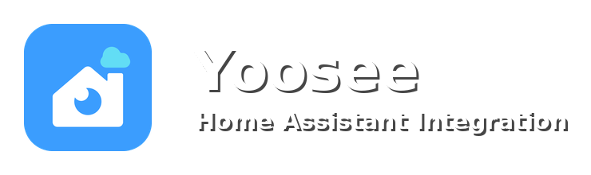
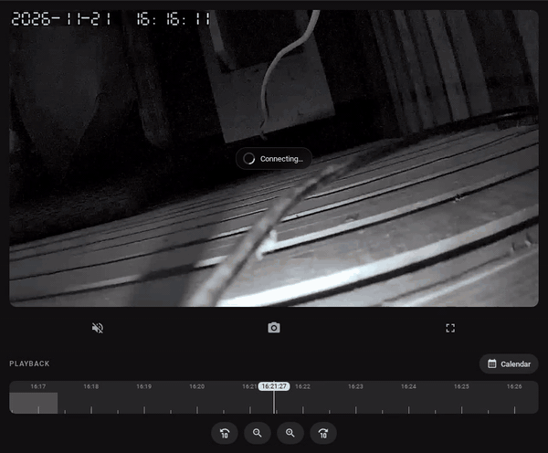

Unofficial Home Assistant integration for Yoosee / Gwell cameras. Not affiliated with, authorized, or endorsed by Yoosee or Gwell. Use at your own risk.

It speaks the same cloud and local protocols as the Yoosee mobile app, so you do not need to set up RTSP or ONVIF separately.

## Features

- Live view (snapshot, HLS, WebRTC) with audio
- SD card playback with a draggable 24-hour timeline
- One account, each camera as its own device and sub-entry
- Local RTSP when the camera is reachable on the LAN, cloud otherwise
- Sidebar panel for live view and playback

## Planned

- PTZ control
- Two-way audio
- Motion alerts

## Contributing

Contributions are welcome. If anything is missing or broken, open an [issue](https://github.com/bukta-attila/ha-yoosee/issues) and let me know what happened.

## Install

### HACS (custom repository)

1. HACS, three-dot menu, Custom repositories.
2. Add `https://github.com/bukta-attila/ha-yoosee`, category Integration.
3. Install Yoosee, then restart Home Assistant.

### Manual

Copy `custom_components/yoosee_cloud` into your `config/custom_components` folder and restart Home Assistant.

## Setup

1. Settings, Devices and Services, Add Integration, Yoosee.
2. Enter your Yoosee account email, password, and region.
3. Pick the cameras to add.

Each camera is a sub-entry with its own settings (gear icon): live source (automatic, local only, cloud only), an optional RTSP password, and an optional external live-view entity. Factory app keys ship with the integration and can be overridden in the account options.

## Without the sidebar panel

The panel is optional. Live view works through each camera's `camera.*` entity in any Lovelace card. Playback is available over the websocket API with the `yoosee_cloud/days`, `yoosee_cloud/recordings`, and `yoosee_cloud/clip` commands, which return a signed, playable stream URL per segment.
